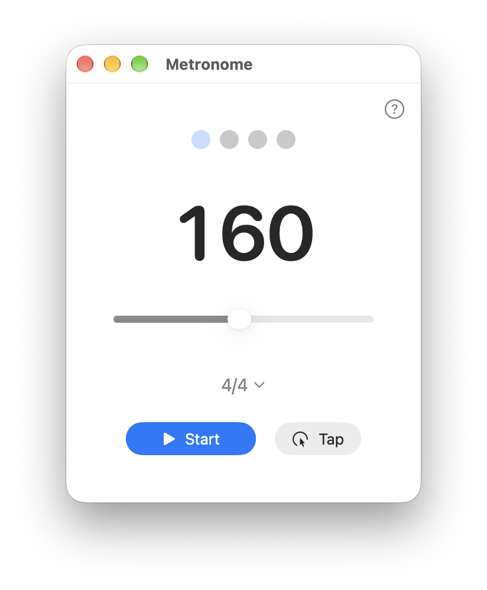

# Metronome



A simple macOS metronome. No ads, just clicks.

## Requirements

| Item | Version |
|---|---|
| macOS (deployment target) | 14.0 (Sonoma) |
| Xcode | 16 or later |
| Swift | 6.0 |
| [XcodeGen](https://github.com/yonaskolb/XcodeGen) | 2.40 or later |

## Building

The Xcode project is generated from `project.yml` and is not checked in.

```sh
brew install xcodegen
xcodegen generate
open Metronome.xcodeproj
```

Or from the command line:

```sh
xcodegen generate
xcodebuild -project Metronome.xcodeproj -scheme Metronome build
xcodebuild -project Metronome.xcodeproj -scheme Metronome test
```

Re-run `xcodegen generate` whenever files are added, removed, or `project.yml` changes.

## Sandboxing and distribution

- App Sandbox is on. Audio output needs no extra entitlement.
- Hardened Runtime is on, so the app can be notarized.

## Future enhancements

- Tap tempo.
- Subdivisions (eighths, triplets, sixteenths).
- A choice of click sounds and volume control.
- A menu bar extra for controlling the metronome without the main window.
